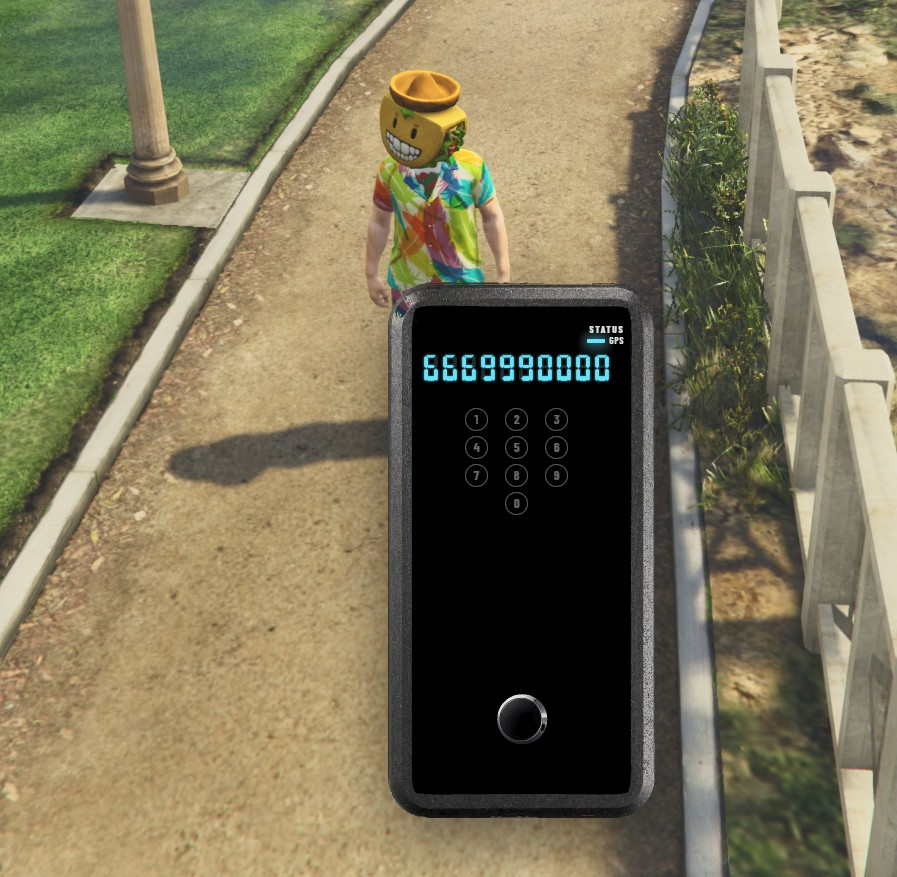

# MrNewbPhoneTracker

Use a tracker item, punch in a phone number, and if that player is online you get a waypoint. If they’re offline or the number’s wrong, the device just says it couldn’t find them and you can try again.

[Documentation](https://mrnewb.github.io/docs/mrnewbphonetracker) · [GitHub](https://github.com/MrNewb/MrNewbPhoneTracker) · [Discord](https://discord.gg/mrnewbscripts)



A little GPS  sitting in the world with a glass screen, keypad, button at the bottom. Escape closes it. A successful ping closes it too and puts the mark on the map.

## Install

Needs [ox_lib](https://github.com/overextended/ox_lib), [Newb_Bridge](https://github.com/MrNewb/Newb_Bridge), a supported phone resource, and an inventory that can take a usable item (ox_inventory is fine).

```cfg
ensure ox_lib
ensure Newb_Bridge
ensure MrNewbPhoneTracker
```

Put it after your phone resource. Add the `tracker` item from the [install docs](https://mrnewb.github.io/docs/mrnewbphonetracker/install) — there’s an icon in `[INSTALL]/images/tracker.png` if you need one.

## Config

Everything lives in `configs/config.lua`:

- `RequiredJob` — who can use it. Default is `police = 0` (any grade). You can also pass a list like `{ 'police', 'sheriff' }`.
- `TrackerItem` — item name, default `tracker`.
- `PingCooldown` — seconds between pings per player (default `10`). The timer starts when you hit dial, even on a miss, so people can’t spam lookups. Set `0` to turn it off.
- `Utility.Debug` — leave this `false` on a live server.

Digits only with Job check, item check, and cooldown all run on the server.

### Phones

Works with gksphone, lb-phone, NPWD, okokPhone, qs-smartphone, qb-phone, qs-smartphone-pro, roadphone, and yseries. Whichever of those is started first gets used.

If you’re on qb-phone / charinfo and the stock lookup isn’t right for your stack, edit `OpenFindSourceByCharPhone` in `resource/open/server/phone_lookup.lua`.

## Locales

Strings are in `locales/` via ox_lib, “can’t find them” copy, cooldown text, blip label, the lot. `STATUS` and `GPS` stay as printed hardware labels on purpose.

## Support

Docs are at https://mrnewb.github.io/docs/mrnewbphonetracker. Stuck? https://discord.gg/mrnewbscripts